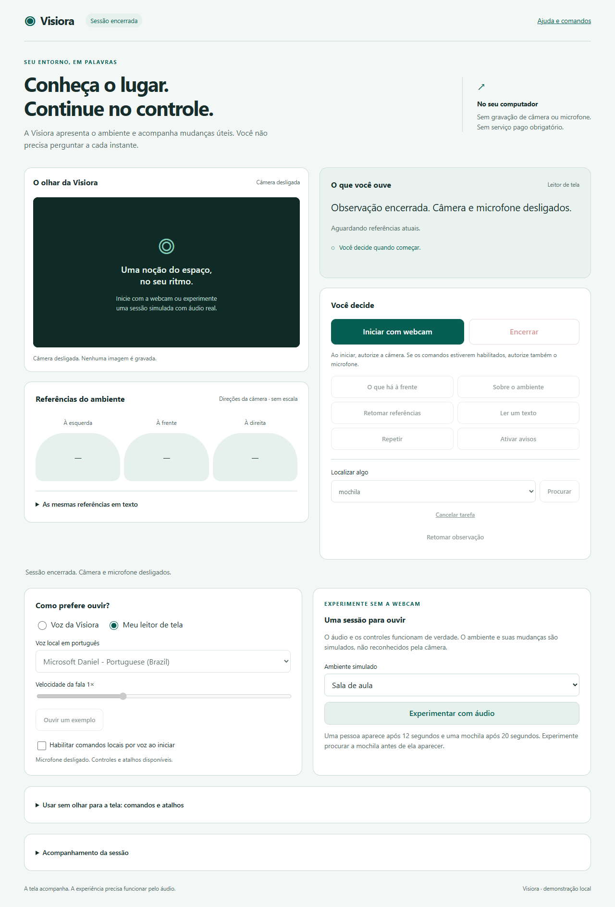

# Visiora

O Visiora é um protótipo de assistência visual para pessoas cegas ou com baixa visão. Seu objetivo é apresentar o ambiente por áudio, acompanhar mudanças relevantes e apoiar a compreensão do que está diante da câmera.

> O projeto está em desenvolvimento. As descrições podem conter erros e omissões. O Visiora ainda não oferece orientação segura para deslocamento e não substitui bengala, cão-guia ou acompanhamento especializado.

## Versões do projeto

O repositório reúne etapas diferentes do Visiora:

- **[Protótipo web atual](web/)** — aplicação em TypeScript com ambientação por voz em português, câmera no navegador e modelos locais para objetos, pessoas e ambientes. Inclui também uma integração experimental opcional com Luna por um servidor local.
- **Implementação C# anterior** — código na raiz deste repositório, preservado para consulta. Essa versão usa integrações externas de visão e voz e tem requisitos próprios.
- **Demonstração C# reconstruída** — outra linha de desenvolvimento, atualmente em uma cópia local e ainda não incluída neste repositório. Ela usa .NET, YOLOX-S, Ollama, OCR e comandos de voz locais.

## Uma visão da interface



*Captura da demonstração C# local. A interface da versão web disponível neste repositório é diferente.*

## Experimentar a versão web

Requisitos: Node.js 24 ou superior, Git, navegador atualizado e uma webcam para percepção real. O microfone não é necessário no modo local da versão web.

```powershell
git clone https://github.com/Hills808/Visiora.git
cd Visiora/web
npm ci
npm run build
npm run dev
```

Abra [http://127.0.0.1:8080](http://127.0.0.1:8080) no mesmo computador, escolha **Modelos locais** e autorize a câmera. O primeiro uso baixa aproximadamente 168 MB de modelos. A demonstração de cenas usa dados simulados.

O servidor padrão escuta apenas no próprio computador. Para detalhes de instalação e solução de problemas, consulte o [README da versão web](web/README.md).

## Como a versão web funciona

A câmera fornece imagens ao navegador, onde modelos locais analisam objetos, pessoas e o tipo provável de ambiente. A aplicação organiza as observações e seleciona o que comunicar em voz ou texto, reduzindo repetições. A direção apresentada se refere à imagem da câmera e a percepção pode variar conforme enquadramento, iluminação e capacidade do dispositivo.

O modo **Luna** é uma integração opcional em desenvolvimento. Ele depende de um gateway configurado, consentimento para envio de imagens e acesso à API, que pode gerar custos. A chave permanece no servidor. O site estático de apresentação citado na documentação web oferece somente o modo local. Consulte [Configurar o Luna](web/docs/CONFIGURAR-LUNA.md) para requisitos e limites.

## Estado e próximos passos

- Refinar a identificação de objetos de uso cotidiano e a descrição de ambientes.
- Avaliar alternativas para detecção ao vivo, incluindo a possibilidade de treinar um modelo com exemplos específicos.
- Evoluir o reconhecimento de movimentos e gestos com sequências de vídeo.
- Medir tempo até a fala e qualidade em cenários variados, com webcam e dispositivos reais.
- Validar acessibilidade e utilidade junto a pessoas cegas, pessoas com baixa visão e profissionais da área.

O detector pode confundir objetos ou deixar de reconhecê-los. A câmera não fornece distância confiável, mapa espacial completo ou garantia de caminho seguro. Recursos e experimentos de cada versão devem ser interpretados de acordo com a documentação e as evidências correspondentes.

## Privacidade e custos

No modo local da versão web, a análise visual ocorre no dispositivo e não exige chave de API. A instalação e o primeiro carregamento dos modelos precisam de internet. A opção Luna envia capturas ao provedor quando configurada e autorizada; consulte as condições de privacidade e cobrança antes do uso.

## Documentação

- [Versão web, instalação e evidências](web/README.md)
- [Requisitos do projeto](web/docs/REQUISITOS.md)
- [Limitações conhecidas](web/docs/LIMITES.md)
- [Acompanhamento automático](web/docs/ACOMPANHAMENTO-AUTOMATICO.md)
- [Configuração do Luna](web/docs/CONFIGURAR-LUNA.md)

Antes de redistribuir o projeto, verifique as licenças do código, dos modelos e das dependências utilizadas por cada versão.

