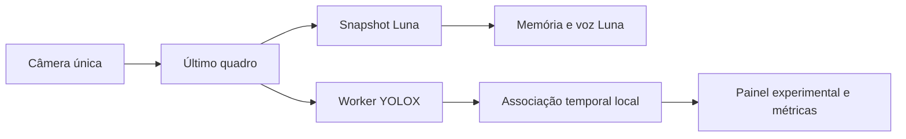

# Percepção contínua observacional — ADR-046

O usuário autorizou iniciar percepção contínua, menor atraso e memória no movimento. A implementação oferece um observador real opcional no Luna e associações temporais no cérebro. Compatibilidade é escolhida pelos recursos efetivamente disponíveis, sem lista de modelos/versões de aparelho. **Não libera fala local, navegação, gatilhos pagos ou aceite H2/H3 de qualidade.**

## Fluxo entregue

Em Ajustes, **Percepção local contínua · experimental → Acompanhar objetos neste aparelho** é desligado por padrão e vale apenas nesta página. A carga dos modelos inicia paralelamente ao Luna. O pipeline reserva o trabalho antes de copiar pixels, mantém uma inferência em voo e não guarda frames pendentes. O próximo despacho usa uma imagem nova. Falhas, parada, consentimento revogado, página oculta e desativação cancelam inicialização e processamento, sem uma conclusão tardia reiniciar a capacidade.

Reutilizados YOLOX Nano/Tiny/S e consenso existente de pessoas, mesmos hashes/limiares, ONNX Runtime Web 1.30.0. Apenas pessoas verificadas pelo consenso recebem `verified`; isso não é calibração de acurácia. Pesos somados: 59.737.071 bytes. O Site privado inclui esses pesos, manifests e partes, sem os modelos SigLIP2/Places365 de ambientes. A opção não abre outro stream nem transmite resultados locais à API.

A entrada conserva proporção e usa letterbox 416/640. Superfícies de preparação são reutilizadas por adaptador; CaptureHub mantém no máximo duas superfícies derivadas e zera-as ao parar. O caminho novo inclui resize intermediário: **não foi demonstrada equivalência de reconhecimento com Camera**, embora use o mesmo worker, decoder e consenso. Uma recuperação GPU→CPU descarta a inferência em falha. Métricas de backend ficam separadas, inclusive após recuperação.

TrackMemory faz associação um-para-um por classe/caixa na mesma vista. Exige três quadros distintos, trata candidato/confirmado/oculto, retira direção na oclusão e não renova `lastObservedAt` por previsão. Cruzamento ambíguo suspende associação e separação posterior exige candidato novo; isso pode aumentar perdas. Giro confirmado e mudança ampla retiram a geometria. Cada despacho guarda revisão da vista; A→B→A não revalida resultado antigo. Fonte, geração, ordem e idade são verificadas. Não existe identidade biométrica, distância ou mapa persistente.

A lista é separada das capturas Luna. Observações locais não alteram sua narração, validade ou agenda paga. O diagnóstico guarda apenas estados, tempos e contagens limitados, sem rótulos, caixas, IDs de tracks, trajetórias ou pixels. A falha local usa aviso neutro, pois o Luna pode estar pausado por outro motivo.

## Orquestração executada

| Responsabilidade | Agente | Entrega |
| --- | --- | --- |
| Adaptador do detector e execução real | `hibrido_detector_sol`, GPT-6.1 Sol | Worker real, geometria, cancelamento, recuperação e benchmark |
| Arquitetura e memória | `hibrido_arquitetura_sol`, papel explorador; modelo não explicitado no retorno da ferramenta | Inventário, TrackMemory e testes de associação/controlador |
| Revisão crítica | `movimento_risco_astra`, GPT-6 Astra | Invariantes de fonte, movimento, saída, falhas e métricas; achados incorporados |
| Integração | agente principal | Controller, sessão, UI, reuso de captura, empacotamento, regressão e publicação |

Skills usadas: `visiora-evaluation` e `sites:sites`. Delegação pela sessão, sem CLI pago. A ferramenta não informou tokens ou preço por agente. Testes fizeram **zero chamadas reais à OpenAI**. Nenhuma alteração de segredo, modelo Luna, ledger, consentimento ou US$ 2/dia.

## Ensaios executados

PC: Intel i7-10700F, RTX 3060, Windows 11 Pro, Chrome 156.0.8078.47, Node 24.11.0. Vídeo público temporal OpenCV `vtest.avi`, primeiros 180 quadros em Y4M 768×576/10 fps; API fake com SQLite em memória, voz controlada. O vídeo é reproduzido como câmera: não é webcam física nem caminhada. [Origem e hash](continuous/video-source.json). Não redistribuímos o vídeo ou frames, nem adotamos sua licença para conteúdo do produto. Sem anotação independente de eventos: mede execução, não precisão ou tracking correto. Houve também regressão de navegador em paralelo; não é benchmark isolado de hardware.

| Medida | GPU WebGPU | CPU WASM |
| --- | ---: | ---: |
| Resultados aceitos, amostra total | 58 | 15 |
| Captura→resultado p50 | 77,5 ms | 1.351,7 ms |
| Captura→resultado p95 | 117,9 ms | 1.397,1 ms |
| Preparação p50/p95 | 3,6 / 10,1 ms | 1,6 / 2,5 ms |
| Inferência p50/p95 | 70,5 / 97,7 ms | 1.347,2 / 1.391,7 ms |
| Resultados aceitos durante 12 s de API pendente | 51 | 8 |
| Ofertas ignoradas enquanto ocupado, nessa espera | 0 | 77 |
| Câmeras / quadros pendentes | 1 / 0 | 1 / 0 |

Arquivos completos: [GPU](continuous/gpu.json), [CPU](continuous/cpu.json). A carga do detector ficou em aproximadamente 3,2/3,7 s nesse ensaio; o primeiro despacho Luna precedeu a conclusão da carga. Quatro resultados locais também chegaram com fala controlada retida. Ambos passaram os seis cenários do E2E real, sem erros de página ou requests fora de loopback. CPU excede CA-D1; GPU nesse recorte não comprova CA-D1 do sistema completo. Captura→resultado não inclui aparecimento físico→captura ou voz audível. Não foi executada comparação antes/depois que sustente percentual de redução de atraso.

Verificações de engenharia:

- **216/216 testes unitários passaram**, incluindo associação, geometria retrato/paisagem, protocolo de worker, recuperação, controlador cancelável e superfícies reutilizadas. Cobertura de linhas do cérebro 99,25%, TrackMemory 100%; cobertura não comprova qualidade visual.
- Tipos estritos e lint passaram. Seis transcrições locais e seis cenários de memória Luna preservados; nenhuma fala local foi adicionada.
- `tests/e2e/hybrid-capture.mjs`: sete cenários H1 fake passaram; continua durante API de 12 s/fala, cancela, reinicia e mantém fonte.
- `tests/e2e/luna-movement.mjs`: 13 cenários passaram. Um teste guardava o callback de voz em variável que um aviso posterior substituía; fixou-se o callback original e confirmou-se recuperação com espera, sem novo envio imediato. Não houve correção de produto para ocultar essa falha de harness.
- Auditoria automática em 390/1440 px passou com painel observacional e Ajustes abertos, temas/texto ampliado: sem violações sérias/críticas ou contraste reforçado; teclado/alvos passaram. Não é teste com VoiceOver/TalkBack.

## Critérios e pendências

| Critério | Evidência/estado |
| --- | --- |
| CA-H1/H9 | Integração com worker real, mesma câmera, cancelamento e fila zero exercitados |
| CA-H2/D4 | Ordem, geração, idade/revisão, A→B→A e giro exercitados em testes; dados reais não foram anotados para avaliar associação correta |
| CA-H3/P3/P5 | **Não aprovado:** faltam eventos anotados, falsos/omissões por classe, cruzamento e translação reais |
| CA-H4/D1 | Exploração no PC; CPU acima da meta; aparelho móvel e surgimento→áudio não medidos |
| CA-H6/H7/D5 | Fallback coberto por worker fake; perda de GPU física, outros aparelhos, RAM, bateria e 30 min pendentes |
| CA-A1/A3/E1/E5 | Checagens automatizadas e limites atualizados; CI é registrado separadamente no PR |
| CA-A2/A4/A5/H11 | VoiceOver/TalkBack, pessoas cegas/baixa visão e O&M **não testados**; zero sessões humanas |

Também não testados: comparação semântica com o pré-processamento anterior, webcam/giroscópio físico nesta fatia, áudio audível, rede móvel, iPhone/Safari/Android reais, aquecimento, objetos perigosos/degraus/vidro, API paga, utilidade em caminhada, cache offline ou disco/rede do sistema operacional. Sem promessa de segurança, precisão ou compatibilidade universal.

Próximo gate: conjunto temporal anotado, perfis móveis e teste controlado de utilidade antes de habilitar fala híbrida ou eventos locais como gatilho Luna. Referências: [ONNX Runtime WebGPU](https://onnxruntime.ai/docs/tutorials/web/ep-webgpu.html), [WebKit e suporte WebGPU](https://webkit.org/blog/17333/webkit-features-in-safari-26-0/), [licença YOLOX](https://github.com/Megvii-BaseDetection/YOLOX/blob/main/LICENSE). Disponibilidade de API no navegador não substitui aquecimento e medição no aparelho.
