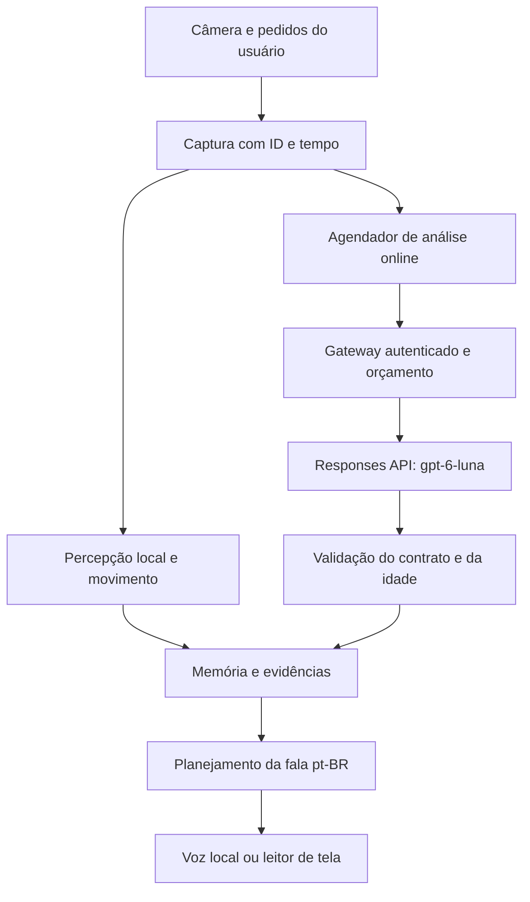

# Visiora — plano de migração para GPT-6 Luna

Data: 18/10/2026, horário de São Paulo. Estado: **planejamento, sem implementação, sem chamadas pagas e sem nova publicação**. Entrada de retomada: `RETOMADA-LUNA-6.md`.

## 1. Decisão e alcance

O usuário pediu preparar a próxima etapa para usar **GPT-6 Luna**, ID oficial `gpt-6-luna`, como modelo principal de compreensão visual. A API receberá pixels, não somente rótulos do detector. Deve interpretar ambientes, objetos, pessoas e relações visíveis, sem receber uma lista de lugares para escolher e sem regras objeto→ambiente.

O público continua sendo pessoas cegas ou com baixa visão, com narração curta em pt-BR. O cérebro decide quando falar; o modelo fornece observações. Silêncio sem mudança, direção relativa ao enquadramento, memória antiga rotulada e ausência de distância inventada continuam obrigatórios. Não incluir reconhecimento facial, percurso, caminho livre ou alertas baseados em opinião do modelo.

Este pedido autoriza **planejar a alternativa paga**. Não define orçamento nem autoriza iniciar cobrança ou enviar as fotografias privadas já anexadas à API. Configuração inicial: gasto permitido **zero**, modo online desligado e consentimento de envio ausente. Quando o usuário mandar continuar, começar pelos contratos, backend fake e testes gratuitos; orçamento/chave/consentimento são requisitos somente antes da primeira chamada real.

Mudança explícita de escopo: o futuro modo Luna terá dependência de internet, cobrança por uso e processamento por terceiro. Isso diverge das seções 6, 8, 9 e RNF7/CA-E4/CA-S2/CA-S3 do plano original. A exceção é específica para esse modo e está no ADR-016; não declarar esses critérios originais cumpridos pelo modo online. A versão local continua como alternativa com capacidades próprias, não como resposta Luna simulada.

## 2. Base real de partida

| Item | Estado conhecido |
|---|---|
| Projeto | Subpasta `visiora`; preservar Git e identidade Sites |
| Versão publicada | 0.3.0, commit `9ac9fadc1844145d66d4bf2b4e8d543f792b9483` |
| Site privado | `appgprj_6ad3aaa3c22881919aef7bcb07d2a927` |
| URL | https://visiora-ambiente.hills808.chatgpt.site |
| Hospedagem | Estática, `.openai/hosting.json` aponta `dist`; não existe API própria |
| Percepção atual | YOLOX Nano/Tiny/S para pessoas/objetos; SigLIP2 q4 + Places365 para ambientes |
| Limitação estrutural | `SceneEstimator` aceita só `PLACES`; `World`/realizador dependem de `LEX`. Conectar Luna sem alterar esses contratos continuaria restringindo o vocabulário |
| Evidência histórica 0.3 | 73 testes unitários, 20 casos de integração; vídeo/voz falsos, pesos reais; não repetir como resultado de Luna |
| Qualidade histórica | Ambiente40: 16 acertos/1 erro/23 dúvidas; pessoas30: 29 acertos/5 falsos/27 omissões. Cadeiras continuam com muitas omissões |

O aplicativo atual não usa Ollama nem um modelo generativo. Não há integração Luna, chave configurada ou evidência de ganho com essa API. Verificar `git status` antes de retomar: os documentos deste planejamento podem estar ainda sem commit remoto.

## 3. Arquitetura proposta

**Cliente:** mantém interface, câmera, controles, cérebro, modo leitor, memória de sessão e voz local. Faz captura JPEG inteira preservando proporção; não usar a miniatura 224×224 dos classificadores como entrada Luna. Uma solicitação em voo, sem fila de fotografias. Pedido novo pendente guarda intenção, não uma imagem velha; captura novamente quando puder processar.

**Gateway TypeScript:** única peça que conhece `OPENAI_API_KEY`. Aplica autenticação, tamanho/formato, modelo permitido, orçamento/reserva, limitação de taxa, timeout e contrato de resposta. O navegador não chama a OpenAI diretamente e não escolhe modelo, endpoint, prompt de sistema ou limites de tokens. Não aceitar URLs de imagem arbitrárias. Não executar ferramentas sugeridas pelo modelo.

**Luna:** fornecedor de observações visuais estruturadas. Sem busca web, MCP, execução de ferramentas, arquivos persistentes ou histórico de conversa no primeiro incremento. Cada pedido tem uma imagem e uma intenção limitada. O modelo não decide falar, gastar, alterar configurações ou atualizar a posição do usuário.

**Memória e narração:** mantêm proveniência de cada afirmação. Corroboração local é evidência adicional, não certificado de verdade. Divergência não transforma automaticamente o detector nem Luna em autoridade. Presença/contagem/direção e tipo de lugar devem poder ser aceitos ou rejeitados separadamente.

### Hospedagem, em duas etapas

1. **Ensaio local primeiro:** gateway e a mesma interface em loopback, com backend fake. Depois, ensaio pago pequeno mediante orçamento e configuração. Isso verifica qualidade antes de migrar hospedagem. Não conectar o Site HTTPS público a localhost como atalho: origem, autenticação e permissões precisam ser tratadas.
2. **Sites hospedado depois do gate de qualidade:** gateway na mesma origem da interface, preservando o Site privado. Autenticação server-side pelo mecanismo Sites; contabilidade persistente em D1 ou mecanismo transacional suportado. Fazer spike de compatibilidade antes da migração. O caminho suportado a avaliar é o starter Vinext, preparado separadamente, portando frontend/assets sem reescrever a experiência. O starter Worker ESM básico **não serve** para copiar este aplicativo: sua documentação só empacota o Worker e não permite assets separados. Não embutir os modelos ONNX no código do Worker.

Não remover `static` nem substituir `.openai/hosting.json` durante o planejamento. Migração de manifesto somente após o servidor servir UI, workers, modelos e `/api` em teste. Manter cópia da 0.3 e rollback. Confirmar disponibilidade/limites de hospedagem e D1; não contratar infraestrutura adicional automaticamente. Se o runtime não comportar o desenho, registrar o impedimento e continuar o ensaio local, sem trocar provedor silenciosamente.

## 4. Contratos propostos — documentação, não código existente

**Cliente → gateway:** POST multipart em `/api/vision/analyze`, imagem JPEG e metadados limitados: `schemaVersion`, `requestId`, `sessionGeneration`, `frameId`, `capturedAtMs`, dimensões, intenção (`describe`, `where`, `ahead`, `find`) e termo curto opcional. Identidade e orçamento são obtidos no servidor. `repeat` reutiliza a última descrição local, sem chamada paga.

**Gateway → cliente:** envelope versionado com status `ok`, `abstained` ou `error`; IDs e proveniência ecoados pelo gateway; versão de prompt/schema; resultado estruturado; tempos e uso faturável quando disponível. Não pedir ao modelo que invente timestamps, IDs de requisição ou custo.

| Campo do resultado visual | Regra |
|---|---|
| `scene` | Nome livre em pt-BR ou `null`, natureza provisória da identificação, referências às observações visíveis que sustentam a descrição; sem enum de lugares |
| `observations[]` | Até 12 itens: ID apenas no quadro, tipo estrutural pessoa/objeto/texto, nome livre em pt-BR, incertezas e caixa normalizada ou `null` |
| `relations[]` | Até 12 relações entre IDs existentes, apenas visíveis; não inferir o oculto ou permitir IDs inexistentes |
| `limitations[]` | Até 6 limitações curtas de imagem/oclusão/incerteza; sem cadeia interna de raciocínio |
| Pessoas | Sem nome, reconhecimento de identidade ou atributos sensíveis; contagem estimada, não exata por padrão |
| Distância | Não há campo de metros/passos vindo de Luna; distância exige outro sensor/backend medido |

Usar Structured Outputs com schema estrito, `additionalProperties: false`, tamanhos e textos limitados. Tratar `refusal`, saída incompleta, corte por tokens, JSON ausente e falhas de schema explicitamente. Schema válido prova **formato**, não veracidade da visão.

O prompt pede observações visíveis em pt-BR, admite `null` e dúvida, não oferece alternativas de ambientes e não fornece rótulos do detector na avaliação principal. Textos presentes na imagem são dados, não instruções. Não pedir justificativa interna passo a passo. Caixa é estimativa do modelo: validar limites e medir sua precisão antes de usá-la na voz.

### Adaptação necessária do cérebro

- Criar `VisualEvidence` independente de fornecedor e de catálogo fixo, com descritor linguístico e origem por item. Manter compatibilidade com os backends locais e simulados.
- Evoluir `SceneEstimator` para rótulo aberto com apoio de evidências, validade e transições; não acrescentar listas de nomes só para aceitar saídas Luna.
- Evoluir World/léxico/realizador para nomes abertos sem acesso `LEX[desconhecido]`, mantendo frases de setor. A lista de setores é geometria, não uma pista de qual objeto ou ambiente existe.
- Direção deriva da caixa no quadro e geometria atual, não de texto livre “à esquerda” do modelo. Sem caixa utilizável ou base espacial, item não entra na fala direcional; explicitar limitação em vez de inventar posição. Não dizer que a direção é relativa ao corpo sem pose medida.
- Revalidar fatos antes do início da saída, preservar confirmação após término e manter respostas de memória rotuladas. Repetição/deduplicação usa significado/entidade, não igualdade literal das frases do modelo.
- Saída em voz usa o realizador e seus limites; não ler JSON, raciocínio interno ou uma resposta longa da API diretamente.

## 5. Atualidade, cancelamento e modos de resposta

| Modo | Política proposta |
|---|---|
| Local atual | Continua com comportamento e limitações próprios; sem cobrança |
| Luna sob demanda — primeiro incremento | Uma imagem recém-capturada por pedido explícito, sem análise automática paga |
| Luna automático — etapa posterior | Só após qualidade, latência e orçamento aprovados; quadro estável e mudança material; nunca a cada frame |

Manter o descarte **>3 s** para fatos descritos como atuais. Se uma resposta sob demanda chegar entre 3 e 10 s, poderá ser apresentada somente como análise da **imagem capturada há X segundos**, em memória/snapshot separado; não alimentar World atual nem scene atual. Acima de 10 s, descartar. Esses limites novos são hipóteses a ensaiar, não validação. Mudança de sessão, parada ou giro invalida uso como descrição atual; não falar durante movimento. Para snapshot antigo, pedir nova consulta após estabilização, sem repetir automaticamente o mesmo pedido pago.

Não aumentar o limite de 3 s para fazer a API “passar”. Se a latência não servir à ambientação ao vivo, manter Luna sob demanda. As metas originais CA-D1 (p95≤400 ms) e CA-D3 (fala≤800 ms) continuam metas não comprovadas; um aviso “analisando” não conta como cumpri-las. Medir processamento de imagem, rede, provedor, validação e início real de saída separadamente.

Cancelar no cliente/servidor não garante cancelamento da cobrança já iniciada no provedor. Uma resposta tardia não pode reativar sessão ou disparar fala. Sem retries automáticos faturáveis no primeiro incremento. Nova tentativa explícita captura imagem nova e é contabilizada como novo pedido.

## 6. Parâmetros iniciais e custo

Todos são **propostas para configuração central**, a calibrar no ensaio; não números mágicos espalhados.

| Parâmetro | Ponto de partida / motivo |
|---|---|
| Modelo e API | `gpt-6-luna`, Responses API; ID somente no servidor, registrar modelo resolvido quando disponível |
| Raciocínio | `none` no ensaio de latência; comparar `low` apenas em desenvolvimento, com orçamento separado e política congelada antes do teste |
| Saída | `max_output_tokens=1200`, incluindo o orçamento aplicável de raciocínio; medir truncamento e custo antes de fixar |
| Imagem | Maior lado até 1280 px, proporção preservada, JPEG qualidade0,85, até 1 MB; medir detalhe versus banda. Servidor revalida tamanho, formato e dimensões com parser suportado |
| Timeout | Até 12 s no gateway; não confundir com os limites de validade de 3/10 s |
| Concorrência | Uma requisição por usuário entre abas/dispositivos, idempotência por usuário + requestId; nenhuma fila de imagens |
| Taxa | No máximo 6 chamadas/minuto/usuário, burst1, sem retries pagos automáticos |
| Orçamento | Total e diário começam em **0**; bloquear sem saldo/reserva. Sugestão de ensaio de até US$2 depende de autorização futura, não é teto já aprovado |
| Automático | Desligado. Se aprovado depois: intervalo mínimo inicial10 s, estabilidade e mudança material; limitador server-side continua prevalecendo |

Referência consultada em 18/10/2026: tarifa padrão de **tokens de texto** do Luna: US$0,10/1M entrada, US$0,01/1M entrada em cache, US$0,50/1M saída. Não converter isso diretamente em preço por imagem, hora ou mês. Confirmar regras atuais de imagens, multiplicadores, saída/raciocínio, cache e modalidade da conta antes do ensaio. A documentação de visão consultada não explicitou uma fórmula específica de `gpt-6-luna` na tabela examinada; essa verificação é bloqueante para uma reserva conservadora confiável.

**Contabilidade:** reservar atomicamente o pior custo permitido antes de enviar; reconciliar com uso real após resposta; pedido duplicado não despacha novamente. Estado persistente contém apenas identidade necessária, requestId, modelo, status e valores/unidades, sem imagem ou descrição. Local: SQLite transacional; validar suporte do Node24 antes de escolher biblioteca. Hospedado: D1 com reserva/limite e exclusão mútua atômicas, não contador em memória de um Worker. Sem armazenamento durável de quota, não ativar gateway pago hospedado.

Se houver timeout/falha após despacho e não houver uso conhecido, manter a reserva conservadora como custo potencial; não liberar e reenviar como se fosse grátis. Falha de banco, preço desconhecido, segredo ausente, orçamento esgotado ou identidade ausente bloqueiam novas chamadas. Limites/alertas do painel do provedor são camada adicional, não garantia do teto do aplicativo. Medir custo por análise, sessão e minuto na frequência ensaiada.

## 7. Privacidade, autenticação e falhas

Antes da primeira captura online, explicar de forma acessível: imagem selecionada será enviada à OpenAI, haverá cobrança e internet será necessária. Consentimento de envio é separado de guardar histórico e de coleta para pesquisa; pode ser revogado e impede novas chamadas. Não reaproveitar as fotos privadas anexadas à conversa sem autorização específica para envio à API.

Segredo só no servidor, fora de bundle, Git, localStorage e manifesto. No Sites, usar configuração de segredo nativa; a referência Sites exige o plugin OpenAI Developers e sua skill `openai-platform-api-key`. Se não estiver disponível, solicitar ativação quando essa etapa começar; não improvisar chave no frontend. Não solicitar chave no chat. Nenhuma chave é necessária para implementar fakes.

No modo hospedado, preservar audience owner-only e usar identidade verificada pela plataforma, com autorização a cada endpoint; não confiar em userId do corpo. Same-origin, validação de Origin/CSRF conforme mecanismo suportado, limite de corpo antes de carregar tudo, sem endpoint aberto e sem aceitar modelo/URL arbitrários. Ensaiar 401/403, quota, duplicação e concorrência. No ensaio local, loopback, origem permitida e proteção contra chamadas de outros sites.

Propor `store:false`, requisição foreground, sem Conversations, Files API, background ou cache de conteúdo próprio. **Isso não equivale a retenção zero no provedor**: existem controles/retenções de monitoramento, cache e exceções descritos na política. Não prometer apagar uma imagem dos sistemas do provedor ao tocar “apagar meus dados”. Verificar política e termos vigentes antes de usar imagens reais. Revogar consentimento/segredo impede novos envios; logs do aplicativo não incluem corpo, base64, descrições, nomes ou tokens secretos.

Estados visíveis: local, online desativado, aguardando configuração/consentimento, analisando, resposta recente, análise de imagem antiga, sem conclusão, sem conexão, limite atingido, falha do serviço. Offline/erro não retorna uma frase Luna inventada. Fallback local deve ser identificado e manter seus limites. Evitar avisos falados repetidos; erro só quando estado muda ou usuário consulta.

## 8. Entregas, tarefas e gates

| ID | Tarefa / saída revisável | Testes e ligação aos CAs |
|---|---|---|
| L00 | Confirmar checkout0.3, instruções, custos/termos e contrato. Separar branch/checkout sem perder alterações do usuário | Histórico e diff; CA-E4/E5. Nenhuma chamada |
| L01 | Tipos model-agnostic, schema/prompt versionados e backend fake; novas cenas de simulador | Nome de ambiente/objeto fora do catálogo; inválidos, recusa, incerteza; CA-F2/F3/F7/F8/F9/P6 |
| L02 | Gateway local e configuração desligada; limites de imagem, auth/origem e erros | Segredo fora do cliente, requisição recusada sem config; CA-E1/E4 e novos CA-L2/L3 |
| L03 | Reserva persistente, idempotência, concorrência, quota e kill switch | Abas simultâneas, reinício, timeout incerto, saldo insuficiente, preço ausente, duplicação; CA-L3 |
| L04 | Agendador/freshness + adaptação World/Scene/realizador; fluxo completo com fake | Inversão de respostas, giro, parada, troca de sessão, TTL, vocabulário aberto e sem repetição; CA-F1/F4/F5/F6/D4/P6 |
| L05 | Configuração real pelo fluxo oficial; orçamento e consentimento definidos pelo usuário | Sem isso, parar antes da API; fakes continuam disponíveis |
| L06 | Smoke pago de poucas imagens públicas, SDK/modelo/schema compatíveis e custo medido | Registrar somente o que executou; CA-L1/L3. Não é benchmark de qualidade |
| L07 | Benchmark de desenvolvimento e confirmação independente, política congelada | Comparar à0.3 em mesmas imagens; falsas afirmações, omissões, lugar, direção e pt-BR; CA-P1/P3/P4 com limitações |
| L08 | Spike de gateway Sites suportado, assets grandes e autenticação; migração separada | Mesmo URL/privacidade; servir UI/assets/API sem segredo; contrato de build/manifesto; CA-E1/L2/L3 |
| L09 | Integração hospedada inicialmente só sob demanda; modo online opt-in | Rede lenta/offline, erros4xx/5xx, reader/voz, dados/cache/consentimento; CA-A1/A2/S4 e CA-L1..L4 |
| L10 | Ensaio automático opcional após medição de mudança, custo e atualidade | Vídeo estático5 min/12 sementes fake + vídeo real; nenhuma cobrança por ciclo sem necessidade; CA-F1/F4/D4/D5 |
| L11 | Revisão de evidência, limites, pacote local e publicação explícita da implementação | Regressões completas, revisão humana e rollback0.3; CA-E1/E2/E3/E5/A4/A5 continuam sujeitos aos ensaios reais |

**Sequência:** L00–L04 podem começar sem custo de API. Gate para L05/L06: chave, orçamento, consentimento, estimador de custo e testes de falha passaram. Gate para L08/L09: qualidade útil e custo/latência aceitáveis em L07. L10 não é pré-requisito para entregar análise sob demanda.

### Arquivos previstos, ainda inexistentes

`src/perception/` (contratos/adaptadores); `src/vision/luna-client.ts` (cliente do gateway, sem chave); `src/vision/analysis-scheduler.ts`; `src/brain/evidence-store.ts`; alterações em `brain/{types,scene,world,brain,realizer}.ts`, `app.ts`, `config.ts`, `diagnostics.ts`, `storage.ts` e Ajuda. Gateway local em `server/` separado de `src/` para não entrar no build do navegador. Posteriormente adaptar entrada HTTP ao runtime Sites verificado; tipos e política de percepção não importam SDK de nuvem.

Documentar prompt/schema em `prompts/luna-vision-v1.md` e `schemas/visual-evidence-v1.json`; fixtures fake em `tests/fixtures/luna/`, testes de scheduler/gateway/budget/brain, E2E fake e harness de benchmark. Dependências novas devem ter versão estável, licença e lockfile revistos antes de instalar; não fixar uma versão de SDK inventada neste plano.

## 9. Avaliação e aceite propostos

Manter desenvolvimento separado do teste: 12 cenas brasileiras adicionais de desenvolvimento e 30 cenas finais (6 tipos×5 locais/cenas) conforme `CONJUNTO-DE-TESTE.md`, com consentimento específico para provedor. Ainda não estão coletadas. Fotos públicas podem servir ao smoke/piloto, com licenças e sobreposição desconhecida com treino declaradas, não como cumprimento de CA-P4. Não misturar quadros do mesmo local entre splits. Privadas anexadas não entram automaticamente.

Anotação humana por afirmação: existência/nome, pessoas e objetos omitidos, contagem, relação/direção e lugar; marcar ambiguidade antes de conhecer a saída. Para linguagem aberta, equivalências de avaliação são definidas no protocolo, nunca inseridas como pistas no prompt. Congelar prompt/modelo/parametrização antes de abrir o teste. Registrar recusas e abstenções, sem escondê-las do denominador.

Gates iniciais de engenharia, **propostos e ainda não medidos**: pelo menos80% de lugares corretos no conjunto brasileiro inteiro, reportando dúvidas separadas; pelo menos95% das afirmações faladas corretas e menos falsas afirmações que0.3 na mesma amostra; menor omissão de itens relevantes sem piorar falsos reconhecimentos de pessoas; zero distância inventada; sem regressão de direção/repetição/giro. Se falhar, não ajustar no teste nem proclamar ganho: voltar ao desenvolvimento e separar novo conjunto de confirmação.

Desempenho: para análise sob demanda, alvo inicial p95≤5 s na rede de referência, sempre respeitando rótulo de antiguidade. Para uso como fatos atuais, exige captura→aceitação≤3 s em cada resposta aceita; se a maioria expirar, o modo ao vivo não está pronto. Contar descartes e tempo até fala, não apenas tempo de servidor. Ensaiar uso30 min, memória, bateria, rede ruim, interrupção e reconexão com teto de gasto previamente aprovado.

| ID novo | Aceite proposto, adicional e sem substituir CAs originais |
|---|---|
| CA-L1 | Modelo recebe pixels; contrato aberto aceita exemplos fora dos34lugares/48objetos sem criar aliases para o teste; resultados possuem fonte e idade |
| CA-L2 | Nenhuma chave/imagem/descrição em bundle/log/cache; consentimento e autenticação necessários antes do despacho; revogação bloqueia novos pedidos |
| CA-L3 | Quota/reserva/idempotência atômicas; concorrência e falha incerta não duplicam despacho nem liberam gasto potencial; limites começam em0 |
| CA-L4 | Resultados tardios nunca viram fatos atuais; snapshot antigo é rotulado; offline/erro/refusal não viram observação positiva |

Testes adversariais obrigatórios: instrução maliciosa escrita em papel na imagem, prompt em nome de objeto, JSON extra/HTML, caixa fora da imagem, pessoa refletida em espelho, cadeira escura parecida com pessoa, oclusão, baixa luz, cena sem pessoas, ambiente sem elementos suficientes, rede que responde depois de parar e servidor que cai após cobrar. Não exigir que o modelo acerte sempre; exigir medição, abstenção e contenção de erro.

## 10. Retomada e pontos pendentes

Próxima ação concreta: **L00 e L01**, confirmar base e implementar os contratos/fakes/testes de vocabulário aberto. Depois gateway e orçamento fake. Não iniciar pela instalação de modelos locais nem pela substituição indiscriminada de todo o cérebro.

Antes de API real, definir com o usuário: orçamento total/diário e quem será cobrado; projeto/chave via fluxo suportado; autorização de imagens; disponibilidade do plugin OpenAI Developers. Antes de hospedagem, resolver spike e quotas Sites/D1. Não exigir que o usuário responda a isso agora para salvar o planejamento.

Nada deste plano foi implementado ou testado com Luna. Nenhuma medição de qualidade, custo real, latência, schema em execução, auth hospedada, privacidade do provedor, câmera real, leitores, pessoas cegas, smartphone ou offline do novo modo foi concluída. Os resultados0.3 são somente a linha de base histórica.

## 11. Fontes e revalidação

Consultadas em18/10/2026. Revalidar antes de chamadas/instalação; o alias de modelo e as tarifas podem mudar.

- Modelo/modalidades/preços: https://developers.openai.com/api/docs/models/gpt-6-luna — entrada imagem/texto, saída texto; sem áudio/vídeo nativos; Structured Outputs suportado; acesso API faturado, não licença de pesos para redistribuição.
- Contrato e recusas: https://developers.openai.com/api/docs/guides/structured-outputs
- Visão, custos e limitações de contagem/localização: https://developers.openai.com/api/docs/guides/images-vision
- Dados/retenção: https://developers.openai.com/api/docs/guides/your-data
- Sites: skill `sites:sites`, referências `identity-and-secrets.md`, `storage.md`, `troubleshooting.md` e README do starter Worker ESM. A referência de segredos direciona `OPENAI_API_KEY` à skill oficial do plugin OpenAI Developers.
- Base do produto: plano completo, arquitetura0.3, ADR-014/015, conjunto de teste e `EVIDENCIAS/RECONHECIMENTO-0.3.0.md`.
