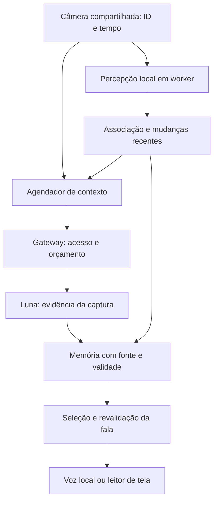

**Compatibilidade por capacidade (orientação do usuário, 24/10/2026):** não exigir modelo de aparelho ou versão específica de sistema. Detectar recursos efetivos, tentar GPU com aquecimento real e usar CPU quando suportada; capacidade ausente é informada. Números de uma máquina são evidência de ensaio, não requisito ou promessa para os demais aparelhos.

## Fatia observacional implementada — ADR-046 (24/10/2026)

Detector real YOLOX Nano/Tiny/S opcional ligado à captura compartilhada; inicia em paralelo e continua durante API/voz, com fila zero. Memória temporal no cérebro distingue candidato/confirmado/oculto e invalida geometria após mudança de vista/giro. Resultados aparecem em painel separado e métricas, sem fala local ou gatilhos pagos. Benchmark com vídeo público mede execução GPU/CPU no PC; não aprova qualidade temporal ou iPhone. H2/H3 e CA-A4/A5 permanecem abertos no que depende de dados anotados e pessoas. [Resultados](EVIDENCIAS/PERCEPCAO-CONTINUA-2026-10-24.md).

**H2 parcial (23/10/2026):** [ADR-030 e medição](EVIDENCIAS/H2-PERCEPCAO-LOCAL-2026-10-23.md) aceleraram o worker YOLOX existente com WebGPU e retorno à CPU na inicialização. RF-DETR e D-FINE não passaram o gate de qualidade de cadeira; nenhum detector novo foi adotado. Ambiente permanece WASM; faltam RAM, carga sustentada, perda de GPU, outros perfis, webcam/voz e conjunto brasileiro. H2/H3 não liberam fala híbrida local no Luna.

## Memória e comunicação revisadas (19/10/2026)

ADR-026 implementa novidades visíveis antes de ausências, atualizações até 25 palavras e menos repetição por pequenas oscilações de posição/certeza/lugar. Ausência não recebe direção antiga; uma captura que perdeu sua vista não recupera posições por pixels parecidos. Texto/voz só entram no histórico após entrega válida. Memória linguística não é tracking nem um mapa atual; o modelo/API e US$ 2/dia continuam iguais.

[Evidências](EVIDENCIAS/MEMORIA-COMUNICACAO.md): 150 testes e 34 cenários de navegador com fontes artificiais. [Protocolo MC-01](AVALIACAO-MEMORIA-COMUNICACAO.md) e [ficha vazia](FICHA-AVALIACAO-MEMORIA.csv) preparados, com zero sessões/participantes/avaliações profissionais. Próximo nessa frente: executar sessões consentidas com pessoas cegas e O&M disponíveis, registrar falhas e revisar as hipóteses. H2 e demais gates híbridos continuam pendentes. Build local atualizado; recarregue com Ctrl+Shift+R. Sem API paga, segredo/ledger alterado ou publicação nesta revisão.

## Orçamento vigente: US$ 2 por dia (19/10/2026)

ADR-025 corrige o teto acumulado antigo: o limite é US$ 2 em cada dia de America/Sao_Paulo, renovado à meia-noite, sem teto total do piloto. O histórico permanece; reservas incertas são atribuídas pelo horário original e uma chamada pendente continua bloqueando concorrência. VISIORA_TOTAL_USD foi aposentado e é ignorado. Reinicie o gateway para aplicar (Ctrl+C e npm run dev:luna), depois recarregue a página. Não foi alterado o segredo ou ledger real nem executada chamada paga. As menções anteriores a US$ 2 totais/dia UTC são históricas e sucedidas por esta regra.

# Visiora — plano de percepção contínua com Luna e execução portátil

**Correção priorizada pelo usuário (19/10/2026):** ADR-024 implementa início no primeiro quadro recente, sem esperar estabilidade, e agrupamento da fala por setor. Movimento menor não descarta capturas qualificadas por idade; mudança ampla retira posições antigas e preserva somente contexto histórico. [Evidências](EVIDENCIAS/LUNA-MOVIMENTO-FALA.md). Sucede a condição de estabilidade no automático Luna descrita no baseline abaixo. Nenhum modelo novo foi ativado; H2 e pesquisa humana permanecem pendentes. Não foi comprovada qualidade em caminhada ou resposta visual em tempo real.

**Atualização após autorização de implementação (18/10/2026):** H0 técnico e H1 implementados conforme ADR-023; [evidência](EVIDENCIAS/H1-CAPTURA-COMPARTILHADA.md). Captura única no modo Luna, consumidor local independente testado com fake, sem detector novo em produção. Próximo: gate H2. H0 humano/medições físicas e H2–H7 continuam pendentes. Os enunciados abaixo que dizem “planejamento; não implementado” descrevem a origem do plano, não anulam essa atualização. Não houve chamada paga ou publicação.

Data: 18/10/2026, São Paulo. **Planejamento; não implementado.** ADR-022. Sucede o planejamento do acompanhamento híbrido em `PLANO-MIGRACAO-LUNA-6.md`, sem alterar o piloto implementado na ADR-021. Nenhuma mudança de interface, dependência, modelo, chave, orçamento, ledger ou publicação nesta etapa.

## 1. Resultado procurado e ponto de partida

Quem usa: pessoa cega ou com baixa visão, em ambiente interno, com câmera de PC/notebook e voz pt-BR ou leitor de tela. Precisa compreender a organização do espaço e suas mudanças com pouco esforço, sem operar perguntas repetidamente. O sistema deve observar enquanto outra análise está em andamento e selecionar informação útil, recente e direcional. Não deve sugerir que percebe tudo, reconhecer identidades, medir distância por caixa, garantir segurança ou orientar percurso. A utilidade será avaliada com pessoas cegas; velocidade e um texto mais natural não substituem essa avaliação.

**Decisão central:** percepção local frequente + interpretação aberta pelo Luna + memória e planejamento de fala independentes. Luna permanece o modelo principal para compreensão aberta do lugar e relações visíveis; a camada local acompanha apenas capacidades demonstradas pelo detector. Não deduzir tipo de ambiente por regras de objetos. Observação contínua não significa inferência em todos os frames nem fala constante. “Tempo real” só poderá qualificar capacidades cujos limites de atraso e qualidade forem medidos e registrados por equipamento.

| Hoje, implementado | Próxima arquitetura, proposta |
| --- | --- |
| Modos Luna e local separados; Luna usa impressão RGB, sem rastreador semântico contínuo | Uma captura compartilhada; percepção local e Luna independentes |
| Luna: uma foto por chamada; intervalo mínimo 4,5 s; captura até 10 s rotulada com idade | Preservar limites do Luna inicialmente; fatos locais recentes separados do contexto da captura |
| Automático aguarda estabilidade e disponibilidade da voz/diálogo; pode perder eventos rápidos | Percepção local continua enquanto API ou voz trabalham; fala e envios têm regras próprias |
| Grupo por nome/setor, sem identidade entre vistas | Associação temporária com evidência e expiração, sem reconhecimento de pessoa |
| Cinco modelos no modo local histórico; ganho modesto de qualidade e latência acima de CA-D1 no ensaio existente | Benchmark do pipeline completo; não carregar todos os modelos automaticamente no híbrido |
| Node 24+, gateway loopback, SQLite no PC | Piloto portátil no PC e futuro gateway compartilhado opcional para várias máquinas |

Baseline de evidência: `EVIDENCIAS/LUNA-CONTINUIDADE.md`: 109 testes e 18 cenários E2E simulados passaram na revisão anterior; seis transcrições locais idênticas. Esses testes não foram executados novamente para este documento e não comprovam qualidade do híbrido. Usuário relatou voz/API funcionando, silêncio estático e continuidade insuficiente. Não existe benchmark físico do híbrido.

## 2. Arquitetura e responsabilidade

| Componente | Responsabilidade e limite |
| --- | --- |
| `CaptureHub` | Um `MediaStream`, permissão única, câmera sem microfone, orientação/espelhamento normalizados; frames com ID, geração e tempo monotônico. Derivados de resolução diferente preservam vínculo e transformação de caixas. Descartar buffers após uso. |
| `DeviceProfiler` | Testar recursos e medir inferência, cópia de imagem, atraso do navegador e consumo acessível. Escolher configuração suportada pelo modelo e perfil de execução; sem inferir capacidade somente pelo nome do SO ou quantidade de núcleos. |
| `LocalPerceptionAdapter` | Inferência sem estado em worker; um trabalho em voo, nenhum acúmulo de frames. Produz observações, não decide narrar. Runtime CPU obrigatório para o perfil amplamente portátil; GPU opcional. Fake com mesmo contrato. |
| `TrackMemory` | No cérebro, associa observações recentes em coordenadas da imagem, trata oclusão e incerteza, gera candidatos a mudanças. É o componente com estado, separado do detector. Não produz pose do mundo, identidade biométrica ou aproximação métrica. |
| `ContextScheduler` | Agrupa mudanças em uma intenção pendente, sem guardar fotografia antiga. Captura a vista atual quando houver estabilidade, consentimento, quota e disponibilidade. Primeiro briefing, nova vista, mudança relevante e pergunta são razões explícitas. |
| `LunaAdapter` + gateway | Preservar Responses, ID permitido, validação de `model`, schema, reserva, cancelamento e recuperação limitada existentes. Um pedido em voo. Sem acesso da chave pelo navegador. Sem substituição silenciosa por outro modelo. |
| `EvidenceMemory` | Mantém fonte, idade, validade e conflitos por afirmação. Contexto de captura Luna não se converte em fato local atual. Não transformar frames repetidos ou duas redes correlacionadas em confirmação independente. |
| `NarrationPlanner` + `Speaker` | Escolhem informação, realizam frase curta em pt-BR e revalidam evidência antes do áudio. Memória do que foi dito só se confirma após saída concluída; texto disponível não prova audição do leitor. |
| `Diagnostics` | Tempos, capacidades, versão/hash de modelo, descartes, falhas e contadores, exportados só por ação do usuário. Sem pixels, impressão RGB, nomes de pessoas, descrição da cena, chave ou telemetria remota. |

Evitar dois controladores disputando a câmera e duas filas de fala. Migração incremental dos módulos atuais; não ligar `Camera` e `SnapshotCamera` simultaneamente, nem copiar `OnlineSession` para criar outro caminho concorrente. Adaptar o cérebro por contratos, sem forçar vocabulário aberto de Luna para dentro de `LEX`/`PLACES` fechados.

## 3. Contratos, associação e atualidade

Novos contratos serão TypeScript estrito e versionados; nomes abaixo são propostos, não interfaces já existentes:

- `FrameStamp`: `sessionGeneration`, `frameId`, `capturedAtMs`, dimensões, orientação, identificação da vista estável e transformação aplicada. Tempos de parede só para auditoria; não comparar relógios de PCs diferentes para determinar idade visual.
- `LocalObservation`: stamp, fonte/modelo/revisão, classe ou rótulo suportado, escore bruto, caixa normalizada, estado de verificação. Escore não é probabilidade calibrada. Sem profundidade fictícia.
- `TrackState`: ID temporário da sessão, primeira/última observação real, caixa, estado candidato/confirmado/oculto/expirado e fontes de suporte. Predição não renova `lastObservedAt` e não conta como detecção nova. Um cruzamento/oclusão pode gerar ambiguidade e encerrar a associação.
- `ChangeEvent`: tipo, IDs relacionados, instante da evidência, direção relativa à câmera, força do suporte e expiração. Ausência exige sucessivas observações utilizáveis do mesmo enquadramento; atraso ou câmera em movimento não contam como ausência.
- `ContextEvidence`: preservar o contrato atual de uma captura; qualquer extensão terá novo schema e testes. IDs retornados pelo Luna valem naquele pedido; não são IDs de tracking. Contexto espacial aberto deve ter suporte nos pixels e vínculo à captura, não ser inventado a partir dos rótulos locais.
- `NarrationFact`: texto a realizar com fatos de suporte, fonte, captura, validade, motivo da relevância e regra de confirmação. Informações de fontes conflitantes são omitidas ou qualificadas, sem escolher automaticamente o maior escore.

**Regras obrigatórias:** fatos atuais locais acima de 3 s nunca entram como atuais (CA-D4); estados dinâmicos podem expirar antes, conforme protocolo congelado no benchmark. Snapshots Luna continuam com máximo de 10 s e idade explicitada (CA-L4), sem relaxar o prazo para acomodar API lenta. Mudança de enquadramento invalida associação geométrica anterior: não reidentificar alguém em outra vista. “Não identifiquei pessoas nesta captura” não significa “a pessoa saiu do local”. Sem métrica e compensação de movimento, não falar que alguém se aproximou em metros ou velocidade.

Uma caixa local pode apoiar uma correspondência ao item Luna no mesmo frame, com classe/posição compatíveis e sem ambiguidade. Isso não valida o restante do texto nem permite transportar todos os atributos de Luna para outro instante. Nomes abertos sem correspondência local permanecem contexto daquela captura. Na primeira fatia, descartar contexto da vista alterada em vez de tentar construir mapa 360°.

## 4. Agendamento independente e controle de sobrecarga

1. Captura recebe frames novos enquanto a sessão está ativa. Preferir callback de vídeo quando disponível, com alternativa testada; não processar o mesmo frame várias vezes para fabricar acertos.
2. Percepção local processa o frame mais recente quando o worker estiver disponível. Se ocupado, descarta a oportunidade; não acumula imagens. Fechar/liberar os recursos transferidos também em erro e cancelamento.
3. Memória acumula evidência temporal e produz mudanças candidatas. Uma detecção isolada não dispara automaticamente uma frase. Permanência, oclusão, câmera em movimento e mudança de vista precisam de testes separados.
4. Gatilho RGB continua como apoio quando o detector não cobre uma mudança; não será a única forma de detectar novidades. Mudanças locais podem marcar uma intenção para Luna; não fazem uma chamada por objeto/frame.
5. Agendador Luna mantém mínimo de 4,5 s, uma chamada em voo, validade, consentimento e reserva. Não criar consultas periódicas de imagem estática para dar aparência de atividade. Se eventos chegarem durante uma chamada, guardar somente uma intenção de reavaliar a vista mais recente, não uma fila de eventos expirados/fotos.
6. Detecção e associação continuam durante voz e chamada Luna. Pausar a voz suspende novos envios automáticos pagos como hoje, mas pode manter processamento local da sessão ativa. Parar, revogar consentimento conforme modo ou ocultar a aba encerram sessão e workers; não trabalhar em segundo plano sem expectativa clara.
7. Primeira fatia preserva bloqueio de envios durante fala/diálogo. Permitir consulta contextual durante fala, se necessário, será experimento separado: nunca sobrescrever descrição aguardando entrega nem aumentar cobrança sem medir benefício.
8. Recuperação Luna segue ADR-021: uma nova captura após ≥15 s para erro temporário conhecido, nova reserva, segunda falha consecutiva pausa. Erros de acesso, quota, contrato e modelo não recuperam automaticamente. Captura descartada pode ser cobrada.

Estados por subsistema: iniciando/ativo/reduzido/indisponível para local; aguardando/analisando/recuperando/pausado para Luna; disponível/ocupada/pausada/indisponível para saída. Não mascarar falha Luna com etiqueta “tudo ativo”. Avisar mudança de capacidade de modo curto, sem narração periódica. Se local continuar após falha Luna, informar que interpretação do ambiente está pausada. Se modelo local falhar, manter apenas snapshot Luna quando autorizado e informar que acompanhamento local parou; não enfraquecer verificação silenciosamente.

## 5. Portabilidade por capacidade medida

O alvo é código comum para PC/notebook Windows, macOS e Linux; ARM64 também entra na matriz. Compatibilidade é um resultado registrado por combinação, não promessa de “qualquer máquina”. Webcam, voz pt-BR, permissões e internet têm disponibilidade própria. Não exigir CUDA, Python ou GPU dedicada para o caminho principal. Node 24+ é requisito do gateway local atual; a meta hospedada retira essa instalação do aparelho de apresentação.

| Perfil proposto | Caminho | Comportamento |
| --- | --- | --- |
| CPU compatível | Worker + WASM, uma thread quando isolamento não estiver disponível | Modelo/configuração medidos; descartar frames em excesso. Nunca reduzir verificação de pessoas para “parecer rápido”. |
| CPU com recursos adicionais | WASM multithread só após testar suporte e isolamento da origem | Comparar com uma thread; mais threads não são prova de menor latência. Reservar capacidade para voz/UI e testar temperatura/carga. |
| Acelerado | WebGPU opcional quando adaptador, operações do modelo e resultados forem verificados | Comparar equivalência/qualidade ao CPU; falha/perda de dispositivo muda explicitamente para perfil CPU aprovado. Não depender apenas de `navigator.gpu`. |
| Acompanhamento reduzido | Nenhum perfil aprovado cumpre atraso/qualidade mínimos | Informar limitação e oferecer o fluxo de capturas Luna; não declarar tracking rápido nem inventar estado entre fotos. Sem GPU não pode significar tela travada. |

Na inicialização, aquecer e medir um conjunto curto local, sem enviar imagens à API. Proposta inicial de experimento: 10 aquecimentos + 30 amostras, reportando carga inicial separada; validar se essa janela prevê a sessão sustentada. Nenhum perfil é certificado por esse teste curto. Decisão considera p95 de inferência/cópia e atraso da UI, falhas e estabilidade durante câmera/voz, não apenas FPS médio. Testar novo perfil com variação controlada antes de promover; usar histerese e tempo mínimo entre trocas, definidos em configuração após benchmark, para não alternar continuamente.

Adaptação altera frequência e só usa resoluções/preprocessamentos para os quais o modelo foi exportado e avaliado. Mudar tensor fixo 416 para 320 não é uma otimização válida sem exportação/decoder/equivalência. Não baixar automaticamente outro checkpoint, remover confirmadores ou reduzir limiar de confiança em máquina fraca. Variante nova passa pelo mesmo gate de qualidade e tem hash/versão. Inicialmente ajustar carga, não substituir semântica.

WASM é a base proposta por amplitude de suporte documentada. Multithread depende de `crossOriginIsolated`; cabeçalhos COOP/COEP exigem ensaios com assets, service worker e integrações. Implementar worker explícito: o proxy worker do ORT tem restrições com WebGPU. JS/WASM devem ser da mesma distribuição. A lista oficial de navegadores não substitui ensaio do nosso modelo/aplicação. Fontes S1/S2.

### Matriz mínima antes de alegar portabilidade

| Alvo físico a obter | Configurações de ensaio | Estado |
| --- | --- | --- |
| Notebook Windows de entrada, CPU/GPU integrada | RAM/CPU reais registrados; Chrome e Edge; CPU obrigatório | Não executado |
| PC/notebook Windows intermediário | Chrome e Edge; CPU e GPU quando disponível | Não executado para híbrido |
| Mac ARM64 | Safari e Chrome; voz pt-BR disponível/ausente | Não executado |
| PC Linux x64 | Chrome/Chromium e Firefox; uma thread como alternativa | Não executado |
| Máquina com WebGPU utilizável | Falha de inicialização, perda de dispositivo e troca para CPU | Não executado |
| Todos os anteriores | Rede normal/lenta/offline; câmera externa/interna; voz/leitor; alimentação/bateria | Não executado |

RAM de 8 GB pode ser ponto inicial de recrutamento de máquina de entrada, não requisito mínimo certificado. Acrescentar máquina de 4 GB se disponível e registrar capacidade reduzida quando necessário. Emulação/throttling ajuda a testar estados, mas não substitui os equipamentos. Celular/HTTPS integra fase posterior, sem bloquear a investigação em PC.

## 6. Instalação em vários computadores e orçamento único

Separar portabilidade de execução (mesmo código em aparelhos distintos) de serviço compartilhado (chave/quota comuns). Hoje copiar o projeto e `.env` **não compartilha o SQLite**: dois PCs podem autorizar gastos separadamente com a mesma chave. O limite local não é limite global do provedor.

| Implantação | Vantagem | Condição para uso |
| --- | --- | --- |
| A. Piloto local portátil | Sem serviço remoto próprio; reaproveita Node/SQLite/loopback | Um gateway de cada vez para a chave/orçamento de apresentação; migração administrativa do histórico com serviço parado. Não copiar SQLite em uso ou seus arquivos pela metade. Chaves, ledger e modelos de pesquisa privados ficam fora do pacote público/Git. |
| B. Front acessado por HTTPS + gateway compartilhado | Mesma experiência em outros PCs, sem instalar servidor local ou copiar chave | Futuro backend autenticado com um registro transacional autoritativo de orçamento, idempotência, taxa e pendências para todas as máquinas. Não implementado nesta fase. |

Escolha de evolução: A para desenvolver/medir o híbrido; B como destino para apresentação em vários computadores e uso com orçamento compartilhado. O site Sites atual é estático e não oferece esse gateway. Migrar hospedagem só em fatia própria, preservando identidade/audiência e com testes de autorização. No runtime Sites/Workers, percepção continua no aparelho; não executar ONNX pesado no gateway. D1 ou mecanismo transacional suportado precisa ser estudado na implementação, sem assumir que sequência de consultas é atomicidade.

No modo B, identidade verificada no servidor, quota comum por proprietário/projeto/chave e reserva atômica antes do despacho. Não confiar em `userId`/modelo/preço vindos do cliente. Dois PCs concorrentes devem compartilhar o mesmo bloqueio/limite global; múltiplas abas não multiplicam a cota. Falha do armazenamento autoritativo bloqueia chamadas pagas; não recorrer a um contador local para contornar falha. Remover toda rota alternativa que use a mesma chave sem o mesmo ledger. Planos gratuitos de hospedagem/armazenamento, limites e custos adicionais devem ser verificados antes de adotar; não introduzir assinatura ou elevar os US$ 2/dia e US$ 2 totais.

Chave permanece só no gateway; consentimento por dispositivo/sessão, revogação efetiva e metadado de modelo por resposta. Uma sessão não herda permissão de câmera de outra máquina. Não pedir chave no chat, copiar `.env` para navegador ou expor loopback na rede sem HTTPS/autorização. Fakes continuam sem segredo e sem chamadas externas. Para teste em máquina nova: instalar dependências pelo lockfile nela, não copiar `node_modules` entre SOs/arquiteturas; nenhuma referência absoluta ao PC do desenvolvedor nos scripts de produto. Rever detecção do navegador nos testes, hoje com caminho padrão Windows.

## 7. Como a pessoa deve ouvir

O modelo sugere evidências de espaço/relações; o cérebro escolhe conteúdo e mantém consistência. Frases programadas para direção, incerteza e controle de repetição são gramática da resposta, não pistas para adivinhar ambientes. Não introduzir respostas de lugares pré-escritas nem “cama implica quarto”.

| Situação | Informação desejada | O que evitar |
| --- | --- | --- |
| Primeira vista estável | Hipótese de lugar, organização visível e até três referências úteis com direção; abertura/placa apenas quando sustentadas | Lista longa, nome de lugar decidido pelo detector, promessa de saída |
| Pessoa passa pelo enquadramento | Presença/mudança de setor quando confirmada e útil; expirar evento antes de falar se já não se aplica | Narrar cada quadro, identificar quem é ou falar o evento tarde como atual |
| Pessoa deixa de ser identificada | Aviso curto quando relevante, com enquadramento estável e evidência suficiente | Afirmar que saiu do cômodo, contar oclusão como saída |
| Nova vista | Novo resumo espacial recente, preservando a direção relativa à câmera | Dizer “atrás de você” sem pose ou juntar vistas em mapa fictício |
| Cena sem mudanças | Silêncio; estado de funcionamento consultável | Reassegurar periodicamente que “está tudo seguro” |
| Falha ou capacidade reduzida | Explicar o que parou/continua, uma vez por mudança de estado | Fazer silêncio de falha parecer ausência de novidades |

Se a pessoa girar/mover a câmera, bloquear fala espacial e aguardar estabilização. A heurística visual não mede 15°/s; CA-F5 físico exige sensores/verdade-terreno apropriados. Fala local precisa de detecção recente, direção válida e qualidade aprovada; tracker sem detector não confirma presença sozinho. Alertas de proximidade, degraus, caminho livre e instruções para caminhar ficam fora desta entrega. Distâncias só com profundidade métrica válida, ainda ausente.

Planejar relações visíveis para briefing (por exemplo, disposição de mesas ou abertura lateral) exige avaliar o conteúdo Luna e a realização pt-BR; o contrato atual contém relações, mas sua simples presença no JSON não prova que a narração as usa. A fatia de linguagem deve comparar briefing atual e novo com avaliadores, incluindo compreensão e carga auditiva, não apenas contagem de palavras. Manter limites 25 palavras/briefing até 45, um setor por frase e reconhecimento de saída concluída. Sem voz local disponível, informar o modo texto/leitor; não instalar/substituir voz online silenciosamente.

## 8. Ferramentas e decisão de modelo

Nenhuma dependência nova selecionada ou instalada. O runtime existente `onnxruntime-web` está fixado em **1.30.0** no projeto (MIT, já documentado); isso não é afirmação de última versão pública. Preservar versão até um motivo medido para trocar. Gateway Node 24+ atual e Luna permanecem; não há proposta de trocar por outra API ou adotar API Realtime nesta etapa.

| Opção a comparar | Papel e evidência disponível | Gate antes de adoção |
| --- | --- | --- |
| YOLOX Nano/Tiny/S existente | Baseline reutilizável; consenso de pessoas e limitações conhecidos. Ensaio anterior de objetos ~1,3–1,4 s não cumpre CA-D1. Não é solução rápida já comprovada. | Medir pipeline híbrido, qualidade temporal, bytes reais, pico de memória e ganho de agendamento; preservar confirmadores no baseline. |
| Detector compacto via MediaPipe Tasks Vision | Alternativa de infraestrutura com detecção de vídeo; documentação alerta que inferência síncrona bloqueia UI, recomenda worker (S3). A ferramenta não garante modelo melhor. | Fixar versão de biblioteca e checkpoint, hash, licença separada dos pesos, entrada/decoder, bytes, classes, p95 e falsos/omissões; comparar à mesma amostra. Não usar `latest`. |
| ONNX compacto de licença permissiva | Alternativa se o baseline não atingir orçamento de tempo; candidatos específicos só após revisão dos ADRs de modelos já rejeitados | Escolha pelo protocolo de desenvolvimento e confirmação independente; não repetir modelo rejeitado sem evidência nova. Registrar licença de código, pesos e conversão. |
| Associação atual de `World` adaptada ou algoritmo inspirado em ByteTrack | ByteTrack de referência tem licença MIT (S4); implementação original não é um módulo JS pronto e não prova desempenho no navegador | Comparar associação existente com alternativa; fixar revisão da implementação/port, licença e custo; sem dependência Python obrigatória. Não escolher só pelo nome do algoritmo. |

O conjunto brasileiro ainda não foi coletado; os 30/40 exemplos públicos anteriores não viram confirmação independente de uma política ajustada neles. Selecionar configurações em desenvolvimento e congelar antes do conjunto de confirmação. Detecção local não amplia automaticamente para todas as portas/objetos: Luna fornece vocabulário aberto nas capturas; o detector tem cobertura explícita. Não anunciar classe sem suporte para preencher lacuna.

Ficha de cada experimento: revisão/hash do código e peso, fonte/licença, tamanho/transferência, RAM real, modelo de máquina/SO/navegador/energia, provider/threads/input/preprocessamento, carga fria/quente, latência por etapa/p50/p95, erros/abstenções, precisão/recall por classe, eventos corretos/incorretos/omitidos, mudanças de ID e falas falsas. Manter resultados negativos. Qualidade aprovada é condição para fala local; velocidade sozinha permite no máximo gatilho experimental de nova captura Luna.

## 9. Critérios adicionais propostos

Os IDs CA-H* abaixo são **novos critérios propostos para esta evolução**, não substituem CA-F/P/D/A/E/S do plano nem CA-L* da migração. Valores ainda são metas, não resultados. Fixar protocolo antes de medir e registrar desvios por perfil.

| ID | Aceite e como medir | Relação com critérios anteriores |
| --- | --- | --- |
| CA-H1 | Uma permissão/stream por sessão; worker local continua processando frames novos durante API artificial pendente por 12 s e durante fala; fila de frames pendentes zero | CA-D4, CA-L4 |
| CA-H2 | Todas as observações/afirmações mantêm fonte, frame e validade; 100% dos casos antigos/fora de ordem/outra sessão são rejeitados; predição não renova evidência | CA-D4, CA-P6, CA-L1/L4 |
| CA-H3 | Detecção e confirmação temporal de presença/mudança/ausência anotadas em vídeos; metas piloto de precisão ≥95% das referências locais faladas, cobertura ≥90% dos eventos relevantes anotados e ≤1 referência inexistente falada/10 min estáticos, com contagens/abstenções/erros por classe. Não é identidade nem CA-P5 métrico | CA-F4, CA-P3; CA-P5 permanece pendente |
| CA-H4 | CA-D1 original continua meta no PC de referência: p50 ≤150 ms/p95 ≤400 ms para percepção local. Eventos locais confirmados: surgimento→início de voz p95 ≤1,2 s como investigação, reportando o tempo de confirmação e casos suprimidos por giro/gap. Não declarar alerta seguro nem cumprimento CA-D2 a partir de stub | CA-D1/D2; tempo Luna medido separadamente |
| CA-H5 | Em cinco minutos estáticos, no máximo uma fala após briefing; nenhuma fala proibida, velha ou sem direção; interrupção não confirma entrega. Ensaios com 12 sementes e vídeo real | CA-F1..F9, CA-L4 |
| CA-H6 | Cada combinação declarada compatível passa instalação limpa, teste de câmera/voz disponível ou aviso de ausência, perfil aprovado, parada e 30 min sustentados. Perfil reduzido é explicitamente identificado. Matriz registra não testados | CA-D5, CA-E3, CA-A2 |
| CA-H7 | Mudar backend/perfil ou perder GPU não quebra sessão/idade, não reintroduz duplicações e não enfraquece verificação. Caso nenhum backend aprovado reste, capacidade reduzida é anunciada | CA-F4/F6, CA-H2 |
| CA-H8 | Duas máquinas/abas com mesma quota não ultrapassam saldo autorizado em concorrência/falha/reinício; uma reserva autoritativa por ID e nenhuma chamada sem reserva. Sem liberação de custo incerto | CA-L2/L3; obrigatório antes do gateway compartilhado |
| CA-H9 | Zero pixels/segredos/descrições nos novos logs/cache por padrão; revogação/parada/aba oculta cancelam captura, workers e agendamentos; teste de retenção em disco/rede tem escopo registrado | CA-S1/S4, CA-L2 |
| CA-H10 | Luna mede captura→resposta e captura→áudio p50/p95, validade, descarte, falhas e uso por sessão. Não emitir meta de API como garantia; qualidade de lugar segue CA-P4 no conjunto independente e limites declarados | CA-P4, CA-L1/L3/L4 |
| CA-H11 | Primeiro ensaio formativo com 3–5 pessoas cegas e instrutor de O&M, consentido/controlado, compara compreensão do espaço, atraso percebido, repetição e carga auditiva. Aceite final continua ≥8 participantes e CA-A4/A5; não substituir por pessoas vendadas | CA-A4/A5 |

Não baixar metas de qualidade para aprovar hardware fraco; declarar capacidades menores/indisponíveis. Não apresentar 30 FPS de câmera como 30 análises/s ou áudio de teste como voz audível. Guardar todas as amostras e definição de percentil; não excluir falhas do denominador silenciosamente. Para fala, medir evento visível e início audível sincronizados em ensaio consentido; callback é outra métrica.

## 10. Fatias de implementação, em ordem

Cada fatia fecha câmera/simulação → evidência → decisão de fala/estado → saída, com fake e testes. Não construir infraestrutura inteira antes de um fluxo utilizável. Não há estimativa de prazo sem inventário de equipamentos/conjunto e benchmark.

| Fase/IDs de tarefa | Entrega concreta | Testes e saída para seguir |
| --- | --- | --- |
| H0.1–H0.4: baseline e experiência | Congelar estado atual; medir linha de base no PC disponível; escrever roteiros úteis com pessoa/O&M; inventariar máquinas de ensaio e dataset, sem coletar imagens sem consentimento | Reexecutar 109 testes como baseline quando implementar, tipos/lint, 18 E2E e seis transcrições; tempos atuais do Luna em ensaio autorizado, sem prometer medições pagas nesta etapa. Lista de máquinas reais e riscos. CA-F*, CA-H10/H11 |
| H1.1–H1.4: câmera compartilhada com fake | Introduzir CaptureHub e contrato de frame, adaptar um modo por vez; fake local durante Luna pendente. Não mudar modelo nem conteúdo falado em produção | Uma permissão, captura cancelável, modo local preservado, eco de IDs/tempo, 12 s de API pendente sem parar fake, parada e voz concorrente. CA-H1/H2/H9; regressão CA-L* |
| H2.1–H2.5: execução portátil medida | Benchmark em workers do baseline e no máximo duas alternativas; perfis CPU/GPU/reduzido; versões/licenças/hashes registrados antes de integrar | Qualidade + p50/p95/RAM/carregamento sob carga; falhas do provider, threads/isolamento; dados separados por máquina. Escolher caminho que passe qualidade e atraso; se nenhum passar, registrar bloqueio e manter snapshots. CA-H3/H4/H6/H7 |
| H3.1–H3.5: continuidade local | Associação temporária e eventos de presença/setor/ausência; fala local experimental só após gate; sem fala do tracker sem observação recente | Pessoa entra/oculta/retorna/cruza outra, câmera gira, espelho, falsa detecção, evento expira antes de falar. Validar fonte e não inventar aproximação. CA-H2/H3/H5; CA-P3/P6 |
| H4.1–H4.5: Luna com contexto e narração | Gatilho por eventos + RGB, agrupamento de intenção; evidências em memória com fontes separadas; seleção de organização espacial/relações sustentadas, sem catálogo de ambientes | Mudança enquanto API/voz ocupadas, local/Luna discordam, mesmo nome em outra vista, porta versus saída, sessão encerrada, ausência de rede/quota. CA-H1/H2/H5/H10, CA-F9, CA-L* |
| H5.1–H5.4: fala útil com usuários | Comparar roteiros/briefing atual e novo em ambiente controlado; revisar prioridade e quantidade de informação a partir de compreensão/cansaço | Ensaio formativo e correções; depois CA-A4/A5 completos. Sem caminhar guiado pelo app ou testar risco. CA-H11; CA-F* |
| H6.1–H6.5: portabilidade de entrega | Instalação/execução documentadas por SO e arquitetura; pacote sem segredos/dados privados; testes sustentados, leitores e vozes reais; política de perfil publicada | Matriz física, instalação limpa cronometrada, 30 min, limite de memória original, câmera/voz reconexão. CA-H6/H7/H9, CA-E3/D5/A2 |
| H7.1–H7.5: gateway compartilhado opcional | Autenticação e segredo no servidor, quota transacional única, HTTPS e front independente do PC; adaptação Sites em tarefa própria | Concorrência em duas máquinas, falha de storage, timeout/reserva, identidade/CSRF, revogação, verificação `model`, custo. CA-H8/H9, CA-L2/L3. Só depois disponibilizar a outras máquinas com chave compartilhada |

Primeira implementação recomendada: **H0 + H1**, seguida do gate H2. H1 não autoriza ligar os cinco modelos históricos em paralelo no modo Luna e chamar isso de contínuo. Adotar novo detector/tracker requer evidência; se o hardware disponível não cumprir, continuar pesquisa ou restringir capacidade honestamente. Não trocar API, aumentar tokens, resolução, frequência paga ou orçamento para tentar compensar gargalos sem experimento documentado.

## 11. Conjunto de teste e medições

Reutilizar a organização de `CONJUNTO-DE-TESTE.md`: 30 cenas brasileiras independentes (ainda não coletadas), desenvolvimento separado e confirmação congelada por local. Acrescentar vídeos com IDs de eventos, visibilidade, setor, oclusão e timestamps; rótulos não vêm do próprio modelo. Duas pessoas revisam anotações e divergências. Pedir consentimento específico para gravação/pesquisa/API; arquivos privados fora de Git, retenção e exclusão acordadas. Fotos privadas da conversa não são autorizadas para envio externo por este plano.

Roteiros temporais mínimos, repetidos em diferentes cenários de desenvolvimento e depois em confirmação independente: pessoa entra/para; cruza rapidamente; muda de setor; é ocluída; retorna; duas pessoas cruzam; pessoa sai do enquadramento e cadeira fica; câmera gira com pessoa parada; nova vista com mesmos rótulos; mudança somente de luz; espelho/reflexo; câmera travada/repetição do mesmo frame; pouca luz; vista estática por 10 min. Registrar evento omitido, descrição atrasada, associação trocada e frase falsa, sem contar vários frames do mesmo clipe como cenas independentes.

Para CA-H3, anotadores definem relevância, classe, setor e janela válida do evento antes da execução. Matching é um para um; uma fala duplicada não é segundo acerto. Evento narrado fora da janela ou no setor errado não é acerto; evento relevante sem fala é omissão. Precisão = referências locais faladas corretas / todas as referências locais faladas; casos indeterminados são reportados e contam contra a aprovação conservadora. Cobertura = eventos relevantes corretamente descritos / todos os eventos relevantes anotados. Reportar separadamente testes com fala permitida e suprimida por giro/saída indisponível, sem retirar silenciosamente situações difíceis do total. Registrar intervalo de incerteza, denominadores e suficiência da amostra por classe; amostra pequena não sustenta generalização de 95%.

Adicionar testes de carga/erro: inferência mais lenta que captura, rede 1/5/12 s e erro, fala longa, diálogo/voz pausada, revogação, aba oculta, restart, quota esgotada, GPU perdida, modelo ausente/corrompido, backend divergente, duas abas e duas máquinas. Rede simulada testa lógica, não preço/latência real. Teste pago pequeno só em sessão explicitamente autorizada para entradas escolhidas, dentro do saldo; reservar orçamento para confirmação antes de gastar tudo em ajuste.

Resultado por run: configuração imutável, amostras por etapa, p50/p95, taxa de observação real, atraso da UI, RAM/pico quando mensurável, crescimento em 30 min, descartes/filas, eventos e falas corretos/falsos/omitidos, tempo até voz audível, indisponibilidade de voz/leitor, tokens/custo/reservas quando reais. Crescimento de memória usa baseline quente estabilizado e mesmo método; bytes de pesos não são RAM. Se navegador não expõe uma medida, registrar indisponível e usar ferramenta de ensaio consentida, sem inventar um número.

## 12. Fontes oficiais consultadas e pendências

Consulta em 18/10/2026; estas fontes verificam recursos/restrições, não desempenho/qualidade do Visiora. Fontes e limitações também registradas na ADR-022.

- S1 — [ONNX Runtime Web: backends e navegadores](https://onnxruntime.ai/docs/get-started/with-javascript/web.html). WASM CPU tem suporte documentado mais amplo; capacidades GPU variam por ambiente. Revalidar versões no início da implementação.
- S2 — [ORT: flags e opções](https://onnxruntime.ai/docs/tutorials/web/env-flags-and-session-options.html). Multithread exige suporte/isolamento; proxy worker tem restrições com WebGPU; JS/WASM precisam corresponder.
- S3 — [MediaPipe Object Detector para Web](https://developers.google.com/edge/mediapipe/solutions/vision/object_detector/web_js). `detectForVideo` processa frames e é síncrono; worker evita bloquear UI. Isso não seleciona checkpoint, licença de pesos ou tamanho para o projeto.
- S4 — [Licença do ByteTrack de referência](https://github.com/FoundationVision/ByteTrack/blob/main/LICENSE). MIT; não valida licença/qualidade de um port JS nem implica instalação.
- Base interna: plano completo §§7/9/11/12/13; ADR-016..021; arquitetura, limites, migração Luna e evidências de continuidade. Não houve alteração/revisão de preços ou modelo da API nesta etapa.

**Não executado:** híbrido, benchmark novo de modelo/tracker, instalação em outras máquinas, qualidade temporal real, API paga, áudio físico, leitores reais, usuários cegos, ensaio de 30 min e gateway remoto. **Não selecionado:** novo detector, port de tracker, perfil mínimo certificado, serviço remoto/quota comum e política final de associação. Esses são resultados exigidos nas fases, não escolhas ocultas a serem presumidas na retomada.

Retomar por `RETOMADA-LUNA-6.md` e H0/H1. Este pedido é somente planejamento: aguardar instrução de implementação para modificar produto. Não há execução futura agendada.
